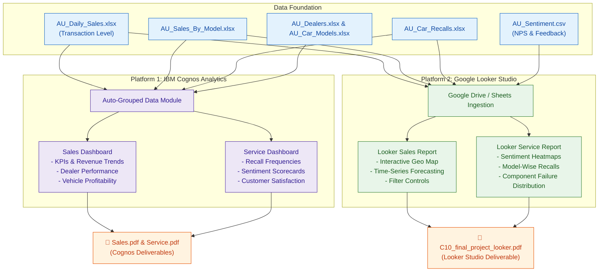

# Automotive Enterprise BI Dashboards — IBM Cognos Analytics & Google Looker Studio

An enterprise business intelligence solution designing multi-page interactive executive dashboards for automotive sales, dealer networks, recalls, and customer sentiment using **IBM Cognos Analytics** and **Google Looker Studio**.

---

## 📌 Executive Summary

Modern automotive enterprises manage complex data streams spanning vehicle unit sales, dealership network performance, defect recalls, and customer sentiment. This project delivers an executive-grade BI reporting platform comparing two industry-standard analytics tools:
1. **IBM Cognos Analytics**: Enterprise-grade reporting utilizing multi-table data modules, automatic grouping, tabbed layouts, drill-downs, and PDF export reporting for Sales and After-Sales Service divisions.
2. **Google Looker Studio**: Cloud-native interactive dashboards built on Google Sheets/Drive connectors, featuring scorecards, geo-maps, treemaps, dynamic date-range and model filter controls, and executive presentation exports.

---

## 🏗️ BI Architecture & Pipeline Flow



---

## 📁 Project Directory Structure

```text
c10_bi_dashboards_cognos_looker_final_project/
├── README.md                            # Comprehensive BI project documentation
├── dashboards_pdf/                      # Exported executive deliverables
│   ├── Sales.pdf                        # IBM Cognos Sales Dashboard export
│   ├── Service.pdf                      # IBM Cognos Service & Sentiment Dashboard export
│   └── C10_final_project_looker.pdf     # Google Looker Studio multi-page export
├── data/                                # Cleaned business datasets
│   ├── AU_Daily_Sales.xlsx              # Granular vehicle transactions dataset
│   ├── AU_Sales_By_Model.xlsx           # Model sales aggregation
│   ├── AU_Car_Recalls.xlsx              # Safety recalls and affected units
│   ├── AU_Car_Models.xlsx               # Vehicle catalog metadata
│   ├── AU_Dealers.xlsx                  # Dealer territory and contact details
│   ├── AU_Sentiment.csv                 # Raw customer survey & sentiment data
│   └── AU_Bad_Sentiment.xlsx            # Negative customer feedback analysis
├── docs/                                # Project briefs and submission rubrics
│   ├── c10_m3_Final Project Overview.md
│   ├── c10_m3_Reading-Final Submission Guidelines and Deliverables.md
│   ├── Final Assignment-Part a- Creating Visualizations Using IBM Cognos Analytics.md
│   └── Final Assignment-Part b- Creating Visualizations Using Google Looker Studio.md
└── screenshots/                         # Verification artifacts and UI steps
    ├── cognos/                          # Cognos data module, templates, and export menus
    └── looker_studio/                   # Looker Studio data import, layouts, and reports
```

---

## 🛠️ Technology Stack & Analytical Capabilities

| Component | Technology | Role & Key Features |
|---|---|---|
| **Enterprise BI** | IBM Cognos Analytics 11.2+ | Enterprise data modeling, intent-driven modeling, auto-grouping, tabbed canvas layouts |
| **Cloud BI** | Google Looker Studio | Rapid cloud visualization, real-time Google Sheets connectors, interactive filters |
| **Data Sources** | Microsoft Excel, CSV | Relational-style tabular data with customer feedback text |
| **Visualization Types** | Geo Maps, Treemaps, Heatmaps, Gauge Cards, Dual-Axis Line/Bar Charts | Executive metric tracking and drill-down analysis |

---

## 🚀 Key Dashboard Deliverables

### 1. Sales Executive Dashboard (Cognos & Looker)
- **Top-Line Metrics**: Total Revenue ($), Unit Quantity Sold, Average Selling Price (ASP).
- **Temporal Analysis**: Monthly and quarterly sales momentum identifying seasonal spikes.
- **Geospatial Intelligence**: Dealer regional distribution across states and cities.
- **Model Breakdown**: Revenue contribution segmented by vehicle trim and fuel type (Electric, Hybrid, Petrol).

### 2. Service, Recalls & Sentiment Dashboard (Cognos & Looker)
- **Safety & Recalls**: Affected vehicle counts by model year, recall classification, and component subsystem (brakes, airbags, transmission).
- **Customer Sentiment Analysis**: Positive vs. Neutral vs. Negative sentiment ratios derived from customer review logs.
- **Dealer Satisfaction Matrix**: Correlating recall resolution times with customer satisfaction ratings.

---

## ✅ Deliverables & Verification
All completed dashboard exports are available as high-resolution PDFs in [dashboards_pdf/](dashboards_pdf/), and configuration screenshots are documented in [screenshots/](screenshots/).
