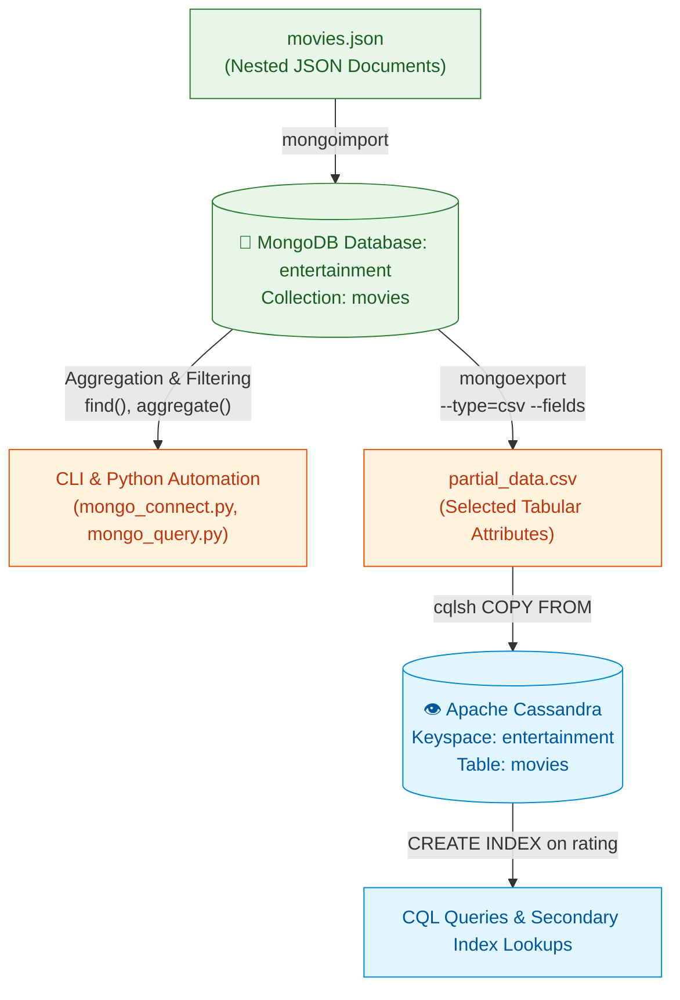

# NoSQL Data Engineering & Polyglot Persistence — MongoDB & Apache Cassandra

An end-to-end NoSQL data engineering consulting project implementing high-throughput document store ingestion, aggregation pipelines, cross-database data migration, and wide-column store querying across **MongoDB** and **Apache Cassandra**.

---

## 📌 Executive Summary

Modern enterprise data architectures rely on polyglot persistence, pairing document databases for flexible schema hierarchical data with wide-column distributed stores for write-optimized temporal queries. This project simulates an end-to-end data consulting workflow:
1. **Document Database (MongoDB)**: Ingests unstructured movie catalog records (`movies.json`), builds multi-stage aggregation pipelines and index strategies, and executes selective projections.
2. **Cross-Engine Migration**: Uses CLI utilities (`mongoexport`) to extract denormalized tabular slices (`partial_data.csv`) conforming to target columnar schemas.
3. **Wide-Column Store (Apache Cassandra)**: Designs `entertainment` keyspaces with replication strategies, constructs distributed table schemas (`movies`), executes bulk imports via `cqlsh COPY`, and provisions secondary indexes for efficient low-latency querying.
4. **Python Automation**: Implements programmatic connectivity, schema discovery, and document insertion scripts using `pymongo`.

---

## 🏗️ Polyglot Architecture & Migration Flow



---

## 📁 Project Directory Structure

```text
c11_nosql_databases_final_project/
├── README.md                            # Comprehensive NoSQL project documentation
├── scripts/                             # Automation scripts
│   ├── mongo_connect.py                 # PyMongo server connection & database discovery
│   └── mongo_query.py                   # PyMongo document insertion & query script
├── data/                                # Data payloads & migration extracts
│   ├── movies.json                      # Source document dataset (JSON format)
│   └── partial_data.csv                 # Filtered dataset exported from MongoDB for Cassandra
├── docs/                                # Reference cheat sheets & assignment specifications
│   ├── c11_m4_cheatsheet_nosql_commands.md
│   ├── c11_m4_final_project_overview.md
│   ├── c11_m4_final_project_submission_guidelines.md
│   └── c11_m4_lab_final_assignment_data_engineering_consulting.md
└── screenshots/                         # Verification artifacts for grading submission
    ├── task1.png                        # MongoDB ingestion (mongoimport)
    ├── task5.png                        # MongoDB CSV export (mongoexport)
    ├── task6.png                        # Cassandra keyspace creation & describe
    ├── task7.png                        # Cassandra table creation & cqlsh COPY
    ├── task8.png                        # Cassandra query execution
    ├── task9.png                        # Cassandra secondary index creation
    └── task10.png                       # Cassandra filtered query using secondary index
```

---

## 🛠️ Technology Stack & Engine Commands

| Category | Technology | Usage in Project |
|---|---|---|
| **Document Store** | MongoDB 6.0+ / `mongosh` | Ingestion, nested querying, document-level updates |
| **Wide-Column Store** | Apache Cassandra 4.0+ / `cqlsh` | Distributed clustering, partition key design, secondary indexing |
| **Python Driver** | `pymongo` | Automated connection handling, cursor operations |
| **Data Formats** | JSON, CSV | Hierarchical documents transformed to columnar tabular records |

---

## 🚀 Step-by-Step Implementation & Key Deliverables

### 1. MongoDB Ingestion & Document Querying
- Ingested `movies.json` into MongoDB `entertainment.movies`:
  ```bash
  mongoimport --db entertainment --collection movies --file movies.json
  ```
- Filtered movies by release year, genre arrays, and review scores using MongoDB comparison operators (`$gt`, `$in`).

### 2. Exporting Tabular Data (`mongoexport`)
- Exported target attributes (`id`, `title`, `year`, `rating`, `director`) into `partial_data.csv`:
  ```bash
  mongoexport --db entertainment --collection movies --type=csv \
    --fields id,title,year,rating,director --out partial_data.csv
  ```

### 3. Apache Cassandra Keyspace, Table & Ingestion
- Created keyspace with SimpleStrategy replication:
  ```cql
  CREATE KEYSPACE entertainment 
  WITH replication = {'class': 'SimpleStrategy', 'replication_factor': 1};
  USE entertainment;
  ```
- Defined table schema and loaded data from CSV:
  ```cql
  CREATE TABLE movies (
      id int PRIMARY KEY,
      title text,
      year int,
      rating double,
      director text
  );
  COPY movies (id, title, year, rating, director) FROM 'partial_data.csv' WITH HEADER = TRUE;
  ```

### 4. Cassandra Secondary Index & Filtering
- Created secondary index to enable query execution on unpartitioned column `rating`:
  ```cql
  CREATE INDEX ON movies (rating);
  SELECT title, year, rating FROM movies WHERE rating > 8.0;
  ```

---

## ✅ Verification & Submission Deliverables
All verification artifacts (screenshots confirming each step from task 1 to task 10) are organized in [screenshots/](screenshots/).
