# Big Data Processing & Analytics — Apache Spark & Hadoop Ecosystem

A production-scale big data engineering project implementing containerized **Apache Spark** master-worker clusters, PySpark DataFrame aggregations, resilient distributed datasets (RDDs), **Hadoop MapReduce** execution, and Spark SQL analytical querying.

---

## 📌 Executive Summary

Modern enterprise analytics requires horizontal scaling to process terabyte- and petabyte-scale unstructured and tabular workloads. This project demonstrates end-to-end big data processing across both legacy batch MapReduce architectures and modern in-memory distributed compute engines:
1. **Containerized Spark Cluster Architecture**: Deploys a standalone Apache Spark 3.5+ cluster using Docker Compose (master with web UI at `:8080`, worker node at `:8081`, RPC at `:7077`), tuning worker executor cores and memory thresholds via `spark-defaults.conf`.
2. **PySpark Job Orchestration (`submit.py`)**: Submits batch PySpark driver scripts connecting programmatically to the Spark Master, creating strongly typed schemas (`StructType`), manipulating distributed DataFrames, and persisting outputs.
3. **Hadoop MapReduce Execution**: Executes distributed WordCount and aggregation jobs over custom corpora (`custom_text.txt`), verifying map, shuffle, partition, and reduce stages with partitioned outputs (`part-r-00000`).
4. **Interactive Spark Analytics & Spark SQL (`notebooks/`)**: Implements comprehensive data engineering pipelines analyzing multi-dataset joins, window functions, and business metric aggregations across `FinalAssignment.ipynb` and `FinalProject.ipynb`.

---

## 🏗️ Big Data Architecture & Execution Flow

```mermaid
graph TD
    classDef spark fill:#fff3e0,stroke:#ef6c00,color:#e65100;
    classDef hadoop fill:#e8f5e9,stroke:#2e7d32,color:#1b5e20;
    classDef nb fill:#e1f5fe,stroke:#0288d1,color:#01579b;
    classDef comp fill:#f3e5f5,stroke:#7b1fa2,color:#4a148c;

    subgraph CLUSTER["Dockerized Apache Spark Cluster (docker-compose.yml)"]
        MASTER["⚡ Spark Master Node<br/>Port 7077 (RPC) / 8080 (Web UI)"]
        WORKER["🛠️ Spark Worker Node<br/>Port 8081 (Web UI) / 1 Core / 512M"]
        MASTER <-->|"Heartbeats & Task Dispatch"| WORKER
        SUBMIT["🐍 submit.py<br/>(PySpark Driver Client)"] -->|"spark-submit / RPC"| MASTER
    end

    subgraph HADOOP["Hadoop Ecosystem (MapReduce)"]
        RAW_TXT["custom_text.txt"] --> MAP["Map Stage<br/>Tokenization"]
        MAP --> SHUFFLE["Shuffle & Sort Stage"]
        SHUFFLE --> REDUCE["Reduce Stage<br/>Aggregation"]
        REDUCE --> OUT["output/part-r-00000<br/>(_SUCCESS verification)"]
    end

    subgraph NOTEBOOKS["Spark SQL & Analytical Notebooks"]
        DATA["dataset1.csv, dataset2.csv, employees.csv"] --> SPARK_DF["PySpark DataFrames<br/>- Schema Enforcement<br/>- Joins & GroupBy<br/>- Spark SQL Temp Views"]
        SPARK_DF --> RESULTS["Analytical Deliverables<br/>(FinalAssignment.ipynb, FinalProject.ipynb)"]
    end

    class MASTER,WORKER,SUBMIT spark;
    class RAW_TXT,MAP,SHUFFLE,REDUCE,OUT hadoop;
    class DATA,SPARK_DF,RESULTS nb;
```



---

## 📁 Project Directory Structure

```text
c12_big_data_with_spark_and_hadoop_final_project/
├── README.md                            # Comprehensive Big Data project documentation
├── spark_cluster/                       # Standalone Apache Spark cluster environment
│   ├── docker-compose.yml               # Multi-container Spark Master & Worker definition
│   ├── submit.py                        # PySpark driver script for standalone submission
│   └── conf/
│       └── spark-defaults.conf          # Spark engine configuration settings
├── hadoop_mapreduce/                    # Hadoop MapReduce batch processing
│   ├── custom_text.txt                  # Input raw text corpus
│   └── output/                          # MapReduce output partition directory
│       ├── _SUCCESS                     # MapReduce execution commit signal
│       └── part-r-00000                 # Distributed word count output
├── notebooks/                           # Jupyter analytics & PySpark workflows
│   ├── FinalAssignment.ipynb            # Graded end-to-end PySpark analytics pipeline
│   └── FinalProject.ipynb               # Spark SQL querying, joins, and aggregations
├── data/                                # Cleaned tabular datasets
│   ├── dataset1.csv
│   ├── dataset2.csv
│   └── employees.csv
└── docs/                                # Assignment specifications
    └── c12_m7_final_project_overview.md
```

---

## 🛠️ Technology Stack & Distributed Frameworks

| Layer | Technology | Function in Project |
|---|---|---|
| **Compute Engine** | Apache Spark 3.5+ (PySpark) | Distributed in-memory data processing, resilient DataFrames, Spark SQL |
| **Cluster Management** | Docker & Docker Compose | Containerized Master-Worker topology simulating distributed nodes |
| **Batch Framework** | Apache Hadoop 3.3+ MapReduce | Distributed disk-based Map, Shuffle, and Reduce processing |
| **Storage & Formats** | HDFS conventions, CSV, Parquet | Distributed partition layouts (`part-r-*`, `part-*`) |

---

## 🚀 How to Run the Infrastructure

### 1. Launching the Spark Master & Worker Nodes
```bash
cd spark_cluster/
docker compose up -d
```
Access the Spark Master Web UI at `http://localhost:8080` to verify connected worker status.

### 2. Submitting a PySpark Application
```bash
python submit.py
```

### 3. Reviewing Hadoop MapReduce Outputs
```bash
cat hadoop_mapreduce/output/part-r-00000
```

---

## ✅ Verification & Deliverables
All PySpark execution outputs, schema prints, and analytical aggregations are preserved with complete cell execution states inside [notebooks/FinalAssignment.ipynb](notebooks/FinalAssignment.ipynb) and [notebooks/FinalProject.ipynb](notebooks/FinalProject.ipynb).
