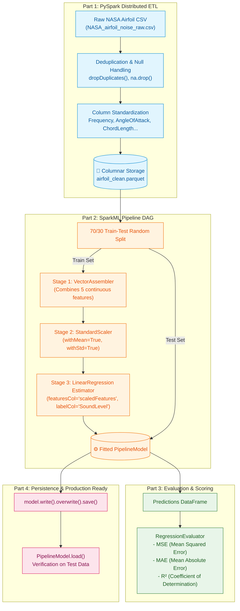

# Scalable Machine Learning Pipelines — Apache Spark & SparkML

An end-to-end distributed machine learning project building scalable ETL, feature transformation, regression modeling, and model serialization pipelines using **Apache Spark (PySpark)** and **SparkML**.

---

## 📌 Executive Summary

Real-world aeronautical engineering requires modeling high-frequency physical phenomena across large wind-tunnel sensor logs. This project implements a distributed machine learning solution utilizing the **NASA Airfoil Self-Noise dataset** (measuring aerodynamic sound pressure levels generated by airfoils across varied Reynolds numbers, angles of attack, and chord geometries):
1. **Distributed ETL & Columnar Storage**: Ingests raw sensor records into PySpark DataFrames, implements strict deduplication and null-handling logic, renames features semantically, and serializes clean records to Apache Parquet format.
2. **3-Stage SparkML Pipeline**: Chains vector assembly (`VectorAssembler`), feature standard normalization (`StandardScaler`), and an estimator (`LinearRegression`) into an atomic, reproducible Spark DAG.
3. **Model Evaluation & Residual Diagnostics**: Computes regression performance metrics (Mean Squared Error, Mean Absolute Error, and $R^2$ Score) on an unseen 30% test split.
4. **Pipeline Serialization & Deserialization**: Persists the fitted `PipelineModel` to disk and verifies serialization integrity by reloading and running inference on test records.

---

## 🏗️ SparkML Pipeline DAG Architecture



---

## 📁 Project Directory Structure

```text
c13_machine_learning_with_apache_spark_final_project/
├── README.md                            # Comprehensive SparkML project documentation
├── notebooks/                           # Jupyter Notebook implementations
│   ├── Final_Project.ipynb              # NASA Airfoil Self-Noise complete SparkML pipeline
│   └── Practice_Project.ipynb           # Practice lab on regression and classification
├── docs/                                # Detailed technical lab guides & specifications
│   ├── c13_m4_final_project.md          # Step-by-step instructions & expected metrics
│   ├── c13_m4_final_project_overview.md # Architecture & mathematical formulation
│   └── c13_m4_practice_project.md       # Practice project guidelines
└── assets/                              # Aerodynamic diagrams & project illustrations
    ├── c13_m4_p1_airfoil_angle_of_attack.jpg
    └── c13_m4_p1_airfoil_with_flow.png
```

---

## 🛠️ Technology Stack & PySpark Components

| Component | Library / Class | Role |
|---|---|---|
| **Core Compute** | `pyspark.sql.SparkSession` | Distributed cluster initialization & DataFrame execution |
| **Feature Extraction** | `pyspark.ml.feature.VectorAssembler` | Consolidates continuous feature columns into single dense vector |
| **Feature Scaling** | `pyspark.ml.feature.StandardScaler` | Centers and standardizes feature vectors to zero mean, unit variance |
| **Estimator** | `pyspark.ml.regression.LinearRegression` | Distributed ordinary least squares / L2 regularized regression |
| **Orchestrator** | `pyspark.ml.Pipeline` | Chaining transformers and estimators into an atomic DAG |
| **Evaluation** | `pyspark.ml.evaluation.RegressionEvaluator` | Metric computation ($R^2$, RMSE, MSE, MAE) |

---

## 🚀 Execution & Verification
To run the full end-to-end pipeline:
1. Open [notebooks/Final_Project.ipynb](notebooks/Final_Project.ipynb) in JupyterLab or Google Colab.
2. Execute all cells to load the dataset, run feature scaling, fit the 3-stage SparkML pipeline, compute evaluation metrics, and persist the model to disk.
