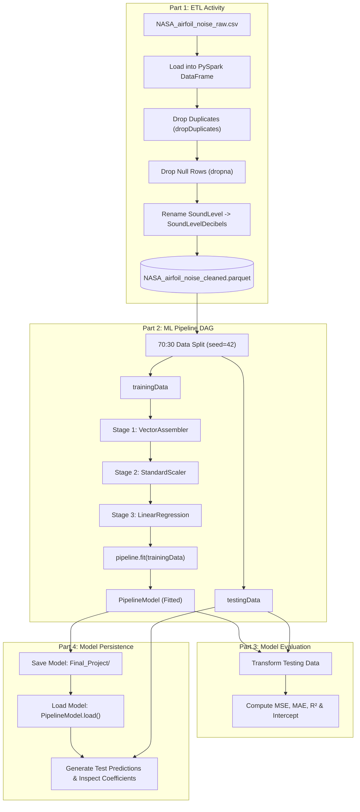

# Final Project - Build an ML Pipeline for Airfoil Noise Prediction

**Estimated Study Time:** 225 mins (Deep Comprehension @ 2.5x) | Hands-on Lab Base: 90 mins

---

## 1. Project Scenario & Overview

You are a data engineer at an aeronautics consulting company. Your company prides itself in being able to efficiently design airfoils for use in planes and sports cars. Data scientists in your office need to work with different algorithms and data in different formats. While they are proficient in Machine Learning theory, they rely on you to execute scalable ETL workloads and construct robust, production-grade Machine Learning pipelines in Apache Spark.

In this project, you will use a modified version of the **NASA Airfoil Self Noise dataset**. You will clean this dataset by dropping duplicate rows and removing rows containing null values. You will construct a SparkML pipeline to train a linear regression model that predicts the sound pressure level (`SoundLevelDecibels`) based on all aerodynamic and geometric features. Finally, you will evaluate the model using multiple regression metrics and persist the fitted pipeline model for production scoring.

---

## 2. Learning Objectives

In this 4-part hands-on capstone project, you will:

1. **Part 1 — Perform ETL Activities:**
   - Load a raw CSV dataset into an Apache Spark DataFrame.
   - Clean data by eliminating duplicate rows and handling null values.
   - Apply column renaming transformations.
   - Store the cleaned, structured data in columnar **Parquet** format.
2. **Part 2 — Create a Machine Learning Pipeline:**
   - Define a `VectorAssembler` stage to assemble all feature columns.
   - Define a `StandardScaler` stage to standardize numerical feature vectors.
   - Define a `LinearRegression` estimator stage to predict sound level.
   - Construct and fit the unified SparkML `Pipeline` DAG.
3. **Part 3 — Evaluate the Model:**
   - Generate predictions on holdout testing data.
   - Compute and analyze regression evaluation metrics: Mean Squared Error (MSE), Mean Absolute Error (MAE), and Coefficient of Determination ($R^2$).
4. **Part 4 — Persist the Model:**
   - Serialize and save the fitted `PipelineModel` to disk.
   - Deserialize and reload the stored pipeline model.
   - Verify persistence integrity by generating predictions on holdout data.

---

## 3. Dataset Description & Aerodynamic Reference

### Dataset Source & Licensing
- **Original Dataset:** NASA Airfoil Self Noise Dataset hosted by the [UCI Machine Learning Repository](https://archive.ics.uci.edu/dataset/291/airfoil+self+noise).
- **License:** Creative Commons Attribution 4.0 International ([CC BY 4.0](https://creativecommons.org/licenses/by/4.0/)).
- **Modified Raw Dataset URL:**
  ```bash
  https://cf-courses-data.s3.us.cloud-object-storage.appdomain.cloud/IBMSkillsNetwork-BD0231EN-Coursera/datasets/NASA_airfoil_noise_raw.csv
  ```

### Aerodynamic Reference Diagrams

The dataset measures self-noise generated by various airfoil blade sections in an anechoic wind tunnel across different frequencies, angles of attack, and chord lengths.


*Figure 4.1: Diagram of an airfoil showing airflow streamline boundaries and wake flow.*


*Figure 4.2: Diagram illustrating the Angle of Attack ($\alpha$) relative to relative wind chord line.*

---

## 4. Pipeline Architecture DAG



---

## 5. Lab Environment Setup

### 5.1 Installing Required Packages

```python
!pip install pyspark==3.1.2 -q
!pip install findspark -q
```

### 5.2 Initializing Spark & Importing Dependencies

```python
# Suppress runtime warnings generated by dependencies
def warn(*args, **kwargs):
    pass
import warnings
warnings.warn = warn
warnings.filterwarnings('ignore')

# Initialize findspark and verify environment
import findspark
findspark.init()

import os
from pyspark.sql import SparkSession
from pyspark.ml.feature import VectorAssembler, StandardScaler
from pyspark.ml.regression import LinearRegression
from pyspark.ml import Pipeline, PipelineModel
from pyspark.ml.evaluation import RegressionEvaluator
```

---

## 6. Part 1: Perform ETL Activity

### Task 1 & 2: Create a SparkSession

```python
# Task 1 & 2: Create a SparkSession
spark = SparkSession.builder \
    .appName("Final_Project") \
    .getOrCreate()

print("SparkSession initialized successfully:", spark.version)
```

### Task 3: Download and Ingest the CSV Dataset

```python
# Download the modified raw CSV dataset
!wget -q https://cf-courses-data.s3.us.cloud-object-storage.appdomain.cloud/IBMSkillsNetwork-BD0231EN-Coursera/datasets/NASA_airfoil_noise_raw.csv

# Ingest CSV into Spark DataFrame with schema inference
df = spark.read.csv("NASA_airfoil_noise_raw.csv", header=True, inferSchema=True)
```

### Task 4: Inspect the Schema and Top 5 Rows

```python
# Print top 5 rows
df.show(5)

# Inspect inferred schema
df.printSchema()
```

### Task 6: Determine Initial Record Count ($R_1$)

```python
rowcount1 = df.count()
print("Initial total rows (rowcount1) =", rowcount1)
```

### Task 7 & 8: Drop Duplicate Records ($R_2$)

```python
# Drop duplicate rows across all columns
df = df.dropDuplicates()

rowcount2 = df.count()
print("Total rows after dropping duplicates (rowcount2) =", rowcount2)
```

### Task 9 & 10: Drop Records Containing Null Values ($R_3$)

```python
# Drop all rows that contain null values
df = df.dropna()

rowcount3 = df.count()
print("Total rows after dropping duplicates and nulls (rowcount3) =", rowcount3)
```

### Task 11: Rename Target Column

```python
# Rename column 'SoundLevel' to 'SoundLevelDecibels'
df = df.withColumnRenamed("SoundLevel", "SoundLevelDecibels")

print("Updated Columns:", df.columns)
```

### Task 12: Persist Cleaned Data to Parquet Format

```python
# Save DataFrame in Parquet format with overwrite mode
df.write.mode("overwrite").parquet("NASA_airfoil_noise_cleaned.parquet")
```

### Part 1 Evaluation Block

```python
print("Part 1 - Evaluation")
print("Total rows = ", rowcount1)
print("Total rows after dropping duplicate rows = ", rowcount2)
print("Total rows after dropping duplicate rows and rows with null values = ", rowcount3)
print("New column name = ", df.columns[-1])
print("NASA_airfoil_noise_cleaned.parquet exists :", os.path.isdir("NASA_airfoil_noise_cleaned.parquet"))
```

---

## 7. Part 2: Create a Machine Learning Pipeline

### Task 1 & 2: Ingest Cleaned Parquet Data

```python
# Ingest cleaned Parquet dataset into a fresh DataFrame
df = spark.read.parquet("NASA_airfoil_noise_cleaned.parquet")

rowcount4 = df.count()
print("Total rows in Parquet DataFrame (rowcount4) =", rowcount4)
```

### Task 3: Stage 1 — VectorAssembler

Assemble all feature columns (excluding `SoundLevelDecibels`) into a single feature vector named `features`:

```python
feature_cols = [c for c in df.columns if c != "SoundLevelDecibels"]
assembler = VectorAssembler(inputCols=feature_cols, outputCol="features")
```

### Task 4: Stage 2 — StandardScaler

Scale `features` using standard scaling into `scaledFeatures`:

$$\text{StandardScaler}(z) = \frac{x - \mu}{\sigma}$$

```python
scaler = StandardScaler(inputCol="features", outputCol="scaledFeatures")
```

### Task 5: Stage 3 — LinearRegression

Create the `LinearRegression` estimator using `scaledFeatures` to predict `SoundLevelDecibels`:

```python
lr = LinearRegression(featuresCol="scaledFeatures", labelCol="SoundLevelDecibels")
```

### Task 6: Construct the SparkML Pipeline DAG

```python
pipeline = Pipeline(stages=[assembler, scaler, lr])
```

### Task 7: Train/Test Split (70:30 with Seed 42)

```python
# Split the data into training (70%) and testing (30%) sets using seed=42
(trainingData, testingData) = df.randomSplit([0.7, 0.3], seed=42)

print("Training Records:", trainingData.count())
print("Testing Records:", testingData.count())
```

### Task 8: Fit the Pipeline Model

```python
# Fit the complete pipeline DAG on the training partition
pipelineModel = pipeline.fit(trainingData)
```

### Part 2 Evaluation Block

```python
print("Part 2 - Evaluation")
print("Total rows = ", rowcount4)
ps = [str(x).split("_")[0] for x in pipeline.getStages()]

print("Pipeline Stage 1 = ", ps[0])
print("Pipeline Stage 2 = ", ps[1])
print("Pipeline Stage 3 = ", ps[2])
print("Label column = ", lr.getLabelCol())
```

---

## 8. Part 3: Evaluate the Model

### Task 1: Generate Predictions on Test Partition

```python
predictions = pipelineModel.transform(testingData)
predictions.select("SoundLevelDecibels", "prediction", "scaledFeatures").show(5)
```

### Task 2: Compute Mean Squared Error (MSE)

$$\text{MSE} = \frac{1}{N} \sum_{i=1}^{N} (y_i - \hat{y}_i)^2$$

```python
evaluator_mse = RegressionEvaluator(
    labelCol="SoundLevelDecibels", 
    predictionCol="prediction", 
    metricName="mse"
)
mse = evaluator_mse.evaluate(predictions)
print("Mean Squared Error (MSE) =", mse)
```

### Task 3: Compute Mean Absolute Error (MAE)

$$\text{MAE} = \frac{1}{N} \sum_{i=1}^{N} |y_i - \hat{y}_i|$$

```python
evaluator_mae = RegressionEvaluator(
    labelCol="SoundLevelDecibels", 
    predictionCol="prediction", 
    metricName="mae"
)
mae = evaluator_mae.evaluate(predictions)
print("Mean Absolute Error (MAE) =", mae)
```

### Task 4: Compute Coefficient of Determination ($R^2$)

$$R^2 = 1 - \frac{\sum_{i=1}^{N} (y_i - \hat{y}_i)^2}{\sum_{i=1}^{N} (y_i - \bar{y})^2}$$

```python
evaluator_r2 = RegressionEvaluator(
    labelCol="SoundLevelDecibels", 
    predictionCol="prediction", 
    metricName="r2"
)
r2 = evaluator_r2.evaluate(predictions)
print("R-Squared (R2) =", r2)
```

### Part 3 Evaluation Block

```python
print("Part 3 - Evaluation")
print("Mean Squared Error = ", round(mse, 2))
print("Mean Absolute Error = ", round(mae, 2))
print("R Squared = ", round(r2, 2))

lrModel = pipelineModel.stages[-1]
print("Intercept = ", round(lrModel.intercept, 2))
```

---

## 9. Part 4: Persist and Verify the Model

### Task 1: Save the PipelineModel to Disk

```python
# Persist the fitted pipeline model to disk
pipelineModel.write().overwrite().save("Final_Project")
print("PipelineModel successfully saved to directory 'Final_Project'.")
```

### Task 2: Load the Persisted Model

```python
# Deserialize and reload the pipeline model
loadedPipelineModel = PipelineModel.load("Final_Project")
print("PipelineModel successfully reloaded.")
```

### Task 3 & 4: Execute Test Predictions with the Reloaded Model

```python
# Transform testing partition using the reloaded model
predictions = loadedPipelineModel.transform(testingData)

# Display the ground truth and predicted SoundLevelDecibels
predictions.select("SoundLevelDecibels", "prediction").show(5)
```

### Part 4 Evaluation Block

```python
print("Part 4 - Evaluation")

loadedmodel = loadedPipelineModel.stages[-1]
totalstages = len(loadedPipelineModel.stages)
inputcolumns = loadedPipelineModel.stages[0].getInputCols()

print("Number of stages in the pipeline = ", totalstages)
for i, j in zip(inputcolumns, loadedmodel.coefficients):
    print(f"Coefficient for {i} is {round(j, 4)}")
```

### Stop SparkSession

```python
spark.stop()
print("SparkSession stopped cleanly.")
```

---

## 10. Summary Matrix: Practice vs Final Project

| Pipeline Dimension | Module 4 Practice Project | Module 4 Capstone Final Project |
|---|---|---|
| **Domain / Problem** | Diamond Price Prediction | NASA Airfoil Self-Noise Aeroacoustics |
| **Input Format** | Raw CSV | Raw CSV (`NASA_airfoil_noise_raw.csv`) |
| **ETL Operations** | Duplication & Null Dropping, Save Parquet | Duplication, Null Dropping, Column Renaming, Save Parquet |
| **Target Label** | `Price` | `SoundLevelDecibels` |
| **Pipeline Stages** | `VectorAssembler` $\to$ `StandardScaler` $\to$ `LinearRegression` | `VectorAssembler` $\to$ `StandardScaler` $\to$ `LinearRegression` |
| **Split Ratio & Seed** | 70:30, `seed=42` | 70:30, `seed=42` |
| **Evaluation Metrics** | MSE, MAE, $R^2$, Intercept | MSE, MAE, $R^2$, Intercept |
| **Persistence Target** | `Practice_Project` | `Final_Project` |
| **Verification** | `PipelineModel.load()` & Coefficient Extraction | `PipelineModel.load()` & Feature Coefficient Mapping |

---

## 11. Authors & License Acknowledgments

- **Author:** [Ramesh Sannareddy](https://www.linkedin.com/in/rsannareddy/)
- **Copyright:** © 2023 IBM Corporation. All rights reserved.
- **Dataset License:** Creative Commons Attribution 4.0 International ([CC BY 4.0](https://creativecommons.org/licenses/by/4.0/)).
