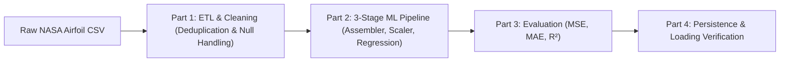

# Final Project Overview

**Estimated Study Time:** 5 mins (Deep Comprehension @ 2.5x) | Nominal Video Runtime: 2 mins (Base Study: 2 mins)

---

## 1. Executive Summary & Objectives

Welcome to the final project of this course! In this project, you will work with the modified version of the **NASA Airfoil Self Noise dataset**. The primary objective is to clean the dataset, construct an end-to-end Machine Learning pipeline, evaluate the model's predictive performance, and persist it for future production use.

---

## 2. Project Architecture & Workflow

You will begin by cleaning the dataset and removing duplicate rows and rows with null values. Doing this step ensures the data is consistent and reliable for further analysis. 

Next, you will construct a Machine Learning pipeline with **three stages**, including a regression stage. This pipeline will enable you to build a model that predicts the `SoundLevel` based on other columns in the dataset. 

Once you’ve trained the model, you will evaluate its performance using appropriate metrics to assess its accuracy and effectiveness. 

Finally, you will persist with the model, saving it for future use. This step ensures that the trained model can be stored and retrieved later, enabling its deployment in real-world applications and making predictions on new data.

---

## 3. Four-Part Project Roadmap

There are four parts to this project:

1. **Part 1: ETL Activities:**
   - Loading the CSV dataset into an Apache Spark DataFrame.
   - Cleaning the data by removing duplicate entries and records containing null values.
   - Applying necessary column transformations.
   - Storing the cleaned data in the optimized **Parquet** format.
2. **Part 2: Machine Learning Pipeline Creation:**
   - Constructing the Machine Learning pipeline DAG, which forms the backbone of your model development.
   - Incorporating feature extraction, scaling, and the linear regression estimator stage to predict `SoundLevel`.
3. **Part 3: Model Evaluation:**
   - Evaluating the fitted pipeline model using relevant regression metrics (such as MSE, MAE, and $R^2$) to gain insights into its performance.
4. **Part 4: Model Persistence & Deserialization:**
   - Saving the trained pipeline model to disk for future production use.
   - Verifying successful loading and persistence integrity by executing predictions from the reloaded model.

---

## 4. Key Learning Outcomes

By the end of this project, you will have gained practical experience in:
- Working with real-world datasets in distributed environments.
- Developing Apache Spark Machine Learning pipelines.
- Evaluating machine learning models using standard metrics.
- Persisting and loading production-ready models for future deployment.

Let's get started!
