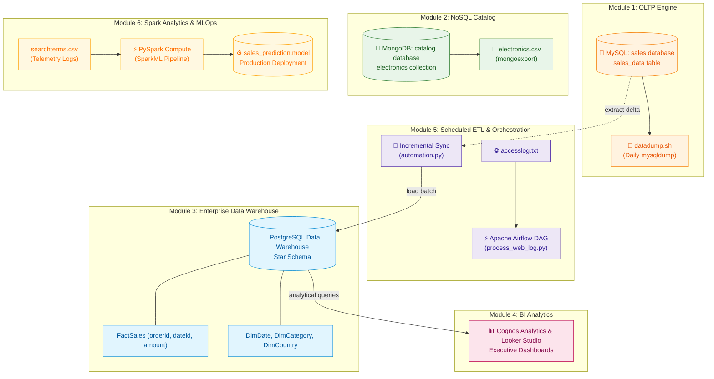

# SoftCart E-Commerce Enterprise Data Platform — Capstone Project

An end-to-end, multi-tier enterprise data engineering platform designed and implemented for **SoftCart** (an online e-commerce retailer). Integrates operational OLTP databases, NoSQL product catalogs, an enterprise PostgreSQL data warehouse, scheduled Apache Airflow ETL pipelines, interactive BI analytics, and Apache Spark MLOps machine learning pipelines.

---

## 📌 Executive Summary

Modern e-commerce enterprises require heterogeneous data architectures capable of servicing high-concurrency transactional checkouts, flexible product catalogs, centralized analytical data warehousing, scheduled ETL log processing, and real-time machine learning predictions.

This Capstone project synthesizes all core competencies of the **IBM Data Engineering Professional Certificate** into a production-grade enterprise data platform across six operational modules:
1. **Module 1 (OLTP Database — MySQL)**: Implements the operational database schema for real-time order processing and writes automated logical backup shell scripts (`datadump.sh`).
2. **Module 2 (NoSQL Product Catalog — MongoDB)**: Models nested, flexible e-commerce catalog documents (`catalog.json`), builds indexing strategies, and exports filtered categories (`electronics.csv`).
3. **Module 3 (Data Warehouse — PostgreSQL Star Schema)**: Implements an analytical warehouse schema (`FactSales`, `DimDate`, `DimCategory`, `DimCountry`), populates millions of historical sales records, and queries multidimensional aggregates using `CUBE`, `ROLLUP`, and Materialized Views.
4. **Module 4 (Business Intelligence & Dashboards — Cognos & Looker)**: Designs executive BI dashboards visualizing top-selling product categories, country-level revenue distributions, and seasonal sales momentum.
5. **Module 5 (ETL Data Pipelines — Apache Airflow & Python)**: Automates web server access log analysis using an Apache Airflow DAG (`process_web_log.py`), extracts IP traffic, filters bot traffic, and automates incremental MySQL-to-PostgreSQL sales data synchronization (`automation.py`).
6. **Module 6 (Big Data Analytics & MLOps — Apache Spark)**: Processes large search engine telemetry (`searchterms.csv`), trains a K-Means clustering model for customer query intent, and persists an end-to-end regression model (`sales_prediction.model`) for production serving.

---

## 🏗️ End-to-End Enterprise Data Architecture



---

## 📁 Project Directory Structure

```text
c14_data_engineering_capstone_project/
├── README.md                            # Comprehensive Capstone documentation & architecture
├── module_1_oltp_mysql/                 # Module 1: Transactional OLTP database
│   ├── datadump.sh                      # Automated mysqldump backup script
│   ├── oltpdata.csv                     # Sample OLTP transaction data
│   └── screenshots/                     # Task 1-7 configuration and query screenshots
├── module_2_nosql_mongodb/              # Module 2: NoSQL product catalog
│   ├── catalog.json                     # Raw product catalog documents (JSON)
│   ├── electronics.csv                  # Filtered category export
│   └── screenshots/                     # MongoDB ingestion and aggregation screenshots
├── module_3_data_warehouse_postgresql/  # Module 3: Enterprise star schema warehouse
│   ├── CREATE_SCRIPT.sql                # Star schema DDL for dimension & fact tables
│   ├── commands_and_outputs.md          # Materialized views, CUBE, ROLLUP queries
│   ├── c14_m3_data_warehouse_reporting.md # Analytics lab guide
│   ├── data/                            # Warehouse dimension datasets (DimCategory, DimCountry, etc.)
│   └── screenshots/                     # ERDs, star schema relationships, and query proofs
├── module_4_bi_analytics_looker_cognos/ # Module 4: Executive Business Intelligence
│   ├── c14_m4_final_assignment_overview.md
│   ├── c14_m4_ibm_cognos.md
│   └── screenshots/                     # Interactive dashboard screenshots (Task 1 to Task 6)
├── module_5_etl_airflow/                # Module 5: ETL automation & pipeline DAGs
│   ├── process_web_log.py               # Production Airflow DAG definition
│   ├── automation.py                    # Incremental database sync automation script
│   ├── mysqlconnect.py                  # Python MySQL connector
│   ├── postgresqlconnect.py             # Python PostgreSQL connector
│   ├── sales.sql                        # Incremental sales extraction DDL
│   ├── sales.csv                        # Cleaned sales dataset
│   ├── c14_m5_Data Pipelines Using Apache AirFlow.md
│   └── screenshots/                     # Airflow web server runs and task execution logs
└── module_6_spark_mlops/                # Module 6: Distributed analytics & SparkML
    ├── Bigdata and Spark-Spark-MLOps-v3-v1.ipynb # Search trends clustering & model persistence
    ├── Practise_Lab_-_Model_saving_and_loading.ipynb # Model serialization practice
    ├── searchterms.csv                  # Raw search telemetry records
    ├── models/                          # Serialized production model artifacts
    │   └── sales_prediction.model/      # Parquet-persisted SparkML regression pipeline
    └── screenshots/                     # SparkML execution proof and evaluation metrics
```

---

## 🛠️ Comprehensive Technology Stack

| Layer | Tools & Technologies |
|---|---|
| **OLTP Database** | MySQL 8.0, `mysqldump`, Linux Bash |
| **NoSQL Database** | MongoDB 6.0+, `mongoimport`, `mongoexport`, `mongosh` |
| **Data Warehousing** | PostgreSQL 13+, Star Schema Modeling, Materialized Views, `CUBE`, `ROLLUP` |
| **Workflow Orchestration** | Apache Airflow 2.x, `BashOperator`, Python Operators |
| **Business Intelligence** | IBM Cognos Analytics, Google Looker Studio |
| **Distributed Big Data & ML**| Apache Spark 3.5+ (PySpark), SparkML, Parquet |
| **Languages & Drivers** | Python 3.10+, SQL, Bash, `psycopg2`, `mysql-connector-python`, `pymongo` |

---

## 🚀 Module-by-Module Summary & Key Deliverables

### Module 1: OLTP Database Architecture (MySQL)
- Deployed MySQL `sales` database and `sales_data` table.
- Implemented automated daily backups via `datadump.sh`:
  ```bash
  mysqldump -u root -p sales sales_data > /home/project/datadump.sql
  ```

### Module 2: NoSQL Product Catalog (MongoDB)
- Ingested 1,000+ catalog items (`catalog.json`) into MongoDB collection `catalog`.
- Created compound index on `category` and `price`.
- Exported target category into CSV:
  ```bash
  mongoexport --db catalog --collection electronics --type=csv --fields id,name,price --out electronics.csv
  ```

### Module 3: Data Warehouse Modeling (PostgreSQL)
- Designed star schema with `FactSales` centered on dimensions: `DimDate`, `DimCategory`, `DimCountry`.
- Executed multidimensional analytical aggregations with `GROUP BY CUBE` and `GROUP BY ROLLUP`.
- Constructed materialized views with automatic refresh for executive reporting.

### Module 4: BI Analytics & Dashboards (Looker & Cognos)
- Connected PostgreSQL data warehouse to IBM Cognos and Google Looker Studio.
- Built executive scorecards tracking gross sales revenue, regional heatmaps, and year-over-year sales trends.

### Module 5: Scheduled ETL Data Pipelines (Apache Airflow)
- Designed production DAG `process_web_log` scheduled to run daily:
  - Task 1: `extract_data` extracts client IP addresses using `cut`.
  - Task 2: `transform_data` filters bot IP `198.46.149.143` using `grep -v`.
  - Task 3: `load_data` archives clean outputs into compressed `weblog.tar`.
- Built Python incremental replication script `automation.py` extracting new transactions from MySQL and inserting into PostgreSQL.

### Module 6: Big Data Analytics & MLOps (PySpark)
- Loaded `searchterms.csv` into Spark DataFrames.
- Identified top query frequencies and applied TF-IDF and K-Means clustering.
- Built regression pipeline predicting sales volume, evaluated model metrics ($R^2$, RMSE), and persisted serialized pipeline (`sales_prediction.model`).

---

## ✅ Verification & Submission Evidence
Every module is supported by full photographic submission evidence (screenshots of terminal outputs, DAG graphs, database records, and charts) located in the corresponding `screenshots/` directory within each module.
