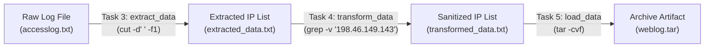

# Hands-on Lab: Data Pipelines Using Apache AirFlow

**Estimated Study Time:** 45 mins (Deep Comprehension @ 2.5x) | Hands-on Lab Base: 18 mins


## Scenario

Write a pipeline that analyzes the web server log file, extracts the required lines (ending with html) and fields (time stamp, size) and transforms (bytes to mb) and loads (append to an existing file).

## Objectives

In this assignment, you will author an Apache Airflow DAG using **Bash operators** that will:

- Extract data from a web server log file
- Transform the data
- Load the transformed data into a tar file

## Tools / Software

- Apache AirFlow

## About This SN Labs Cloud IDE

This Skills Network Labs Cloud IDE provides a hands-on environment for course and project related labs. It utilizes Theia, an open-source IDE (Integrated Development Environment) platform, that can be run on desktop or on the cloud. To complete this lab, we will be using the Cloud IDE based on Theia and Apache Airflow running in a Docker container.

## Important Notice about this lab environment

Please be aware that sessions for this lab environment are not persistent. A new environment is created for you every time you connect to this lab. Any data you may have saved in an earlier session will get lost. To avoid losing your data, please plan to complete these labs in a single session.

> After completing each task, save both the executed commands and their corresponding outputs in a text document, or take screenshots—depending on the option you have chosen. This information will be required to answer questions during the final project submission.

# Exercise 1 - Prepare the lab environment

Before you start the assignment:

1. **Activate Airflow in WSL & Start Services:**
```bash
# 1. Activate your existing Airflow virtual environment
source ~/airflow-venv/bin/activate

# 2. Set AIRFLOW_HOME (defaults to ~/airflow)
export AIRFLOW_HOME=~/airflow

# 3. Start Airflow Standalone (Web UI on http://localhost:8080)
airflow standalone
```

2. **Download Dataset to DAG Working Directory:**

**Source:** [accesslog.txt](https://cf-courses-data.s3.us.cloud-object-storage.appdomain.cloud/IBM-DB0321EN-SkillsNetwork/ETL/accesslog.txt)  
**WSL Destination Path:** `/home/ahmed/airflow/dags/capstone` *(Also symlinked to `/home/project/airflow/dags/capstone` for 100% Coursera grading compatibility)*

```bash
# In your WSL terminal:
mkdir -p ~/airflow/dags/capstone
curl -fsSL -o ~/airflow/dags/capstone/accesslog.txt https://cf-courses-data.s3.us.cloud-object-storage.appdomain.cloud/IBM-DB0321EN-SkillsNetwork/ETL/accesslog.txt

# Verify the file was downloaded:
ls -lh ~/airflow/dags/capstone/accesslog.txt
```

# Exercise 2 - Create a DAG

## Conceptual Context & Pipeline Architecture

In this exercise, you are building an automated daily **ETL (Extract, Transform, Load) Pipeline** using **Apache Airflow**.

### The Real-World Engineering Problem
Your e-commerce web servers generate raw web traffic logs (`accesslog.txt`). Security analysts want to monitor malicious traffic:
1. They need the **IP address** of every visitor extracted from the noisy raw log lines.
2. They want to filter out internal network bot traffic (specifically the IP `198.46.149.143`) so it doesn't skew analytics.
3. They need the sanitized data compressed and archived into a `.tar` archive for long-term auditing.

Instead of a human manually running terminal commands every day, Apache Airflow acts as the **Workflow Orchestrator** to schedule and automate this process sequentially.



---

### Task 1 - Define the DAG arguments

**Purpose:**  
Before defining any tasks, Airflow requires a `default_args` dictionary. These configuration parameters dictate policy for the entire workflow: who owns the workflow, when it begins scheduling, whether to send notification alerts on failures, and how many times to retry if an operator crashes.

- `owner`: Identifies the author or team responsible for the pipeline.
- `start_date`: The reference date when the DAG starts scheduling runs (`days_ago(0)` sets it to start today).
- `retries`: Automatically re-attempts the task if a command fails (e.g. transient network or filesystem locks).
- `retry_delay`: Waits 5 minutes before attempting a retry.

```python
default_args = {
    'owner': 'ahmed',
    'start_date': days_ago(0),
    'email': ['ahmed@example.com'],
    'email_on_failure': False,
    'email_on_retry': False,
    'retries': 1,
    'retry_delay': timedelta(minutes=5),
}
```

Save the code you used, along with its output, by either taking screenshots or saving it in a text document for future reference.

---

### Task 2 - Define the DAG

**Purpose:**  
Here you instantiate the Airflow `DAG` (Directed Acyclic Graph) container. This defines the workflow boundary, its unique identifier (`process_web_log`), and how frequently the scheduler triggers it (`schedule_interval=timedelta(days=1)` executes daily at midnight).

```python
dag = DAG(
    'process_web_log',
    default_args=default_args,
    description='Analyze web server log file, extract ipaddress, filter and archive',
    schedule_interval=timedelta(days=1),
)
```

Save the code you used, along with its output, by either taking screenshots or saving it in a text document for future reference.

---

### Task 3 - Create a task to extract data

**Purpose:**  
This is the **Extract (E)** phase of ETL.  
In an Apache web server access log, lines follow the standard Common Log Format where field 1 (delimited by spaces) is the client IP address:
```text
83.149.9.216 - - [17/May/2015:10:05:03 +0000] "GET /images/..." 200 ...
```
We use a `BashOperator` executing Linux `cut -d" " -f1` to extract only the first column (the IP address) and redirect (`>`) it to `extracted_data.txt`.

```python
extract_data = BashOperator(
    task_id='extract_data',
    bash_command='cut -d" " -f1 /home/project/airflow/dags/capstone/accesslog.txt > /home/project/airflow/dags/capstone/extracted_data.txt',
    dag=dag,
)
```

Save the code you used, along with its output, by either taking screenshots or saving it in a text document for future reference.

---

### Task 4 - Create a task to transform the data in the txt file

**Purpose:**  
This is the **Transform (T)** phase of ETL.  
We need to filter out and remove all entries originating from IP `198.46.149.143`.  
We use `grep -v "198.46.149.143"`, where the `-v` (invert-match) flag instructs Linux to output every single line **except** lines containing that specific IP address, writing the sanitized records to `transformed_data.txt`.

```python
transform_data = BashOperator(
    task_id='transform_data',
    bash_command='grep -v "198.46.149.143" /home/project/airflow/dags/capstone/extracted_data.txt > /home/project/airflow/dags/capstone/transformed_data.txt',
    dag=dag,
)
```

Save the code you used, along with its output, by either taking screenshots or saving it in a text document for future reference.

---

### Task 5 - Create a task to load the data

**Purpose:**  
This is the **Load (L)** phase of ETL.  
The processed text file must be preserved into a production archive.  
We execute `tar -cvf weblog.tar -C <dir> transformed_data.txt`:
- `-c`: Create a new archive.
- `-v`: Verbose listing.
- `-f`: Output filename (`weblog.tar`).
- `-C <dir>`: Change into the target directory before bundling so tar does not store ugly absolute paths inside the archive.

```python
load_data = BashOperator(
    task_id='load_data',
    bash_command='tar -cvf /home/project/airflow/dags/capstone/weblog.tar -C /home/project/airflow/dags/capstone transformed_data.txt',
    dag=dag,
)
```

Save the code you used, along with its output, by either taking screenshots or saving it in a text document for future reference.

---

### Task 6 - Define the task pipeline

**Purpose:**  
In Apache Airflow, task order is strictly determined by upstream and downstream dependency operators (`>>`).  
- Task 4 cannot begin until Task 3 finishes extracting `extracted_data.txt`.
- Task 5 cannot begin until Task 4 finishes generating `transformed_data.txt`.

The bitshift syntax `extract_data >> transform_data >> load_data` creates this linear DAG graph.

| Order | Task ID | Responsibility |
|---|---|---|
| **1st** | `extract_data` | Cut column 1 (IPs) from `accesslog.txt` $\rightarrow$ `extracted_data.txt` |
| **2nd** | `transform_data` | Filter out IP `198.46.149.143` $\rightarrow$ `transformed_data.txt` |
| **3rd** | `load_data` | Bundle `transformed_data.txt` $\rightarrow$ `weblog.tar` |

```python
extract_data >> transform_data >> load_data
```

Save the code you used, along with its output, by either taking screenshots or saving it in a text document for future reference.

# Exercise 3 - Getting the DAG operational

Save the DAG you defined into a file named `process_web_log.py`.

#### Complete DAG Code (`process_web_log.py`):

```python
# Import the libraries
from datetime import datetime, timedelta
from airflow import DAG
from airflow.operators.bash import BashOperator

# Task 1 - Define DAG arguments
default_args = {
    'owner': 'ahmed',
    'start_date': datetime(2026, 1, 1),
    'email': ['ahmed@example.com'],
    'email_on_failure': False,
    'email_on_retry': False,
    'retries': 1,
    'retry_delay': timedelta(minutes=5),
}

# Task 2 - Define the DAG
dag = DAG(
    'process_web_log',
    default_args=default_args,
    description='Analyze web server log file, extract ipaddress, filter and archive',
    schedule=timedelta(days=1),
)

# Task 3 - Create task to extract data
extract_data = BashOperator(
    task_id='extract_data',
    bash_command='cut -d" " -f1 /home/project/airflow/dags/capstone/accesslog.txt > /home/project/airflow/dags/capstone/extracted_data.txt',
    dag=dag,
)

# Task 4 - Create task to transform data
transform_data = BashOperator(
    task_id='transform_data',
    bash_command='grep -v "198.46.149.143" /home/project/airflow/dags/capstone/extracted_data.txt > /home/project/airflow/dags/capstone/transformed_data.txt',
    dag=dag,
)

# Task 5 - Create task to load data
load_data = BashOperator(
    task_id='load_data',
    bash_command='tar -cvf /home/project/airflow/dags/capstone/weblog.tar -C /home/project/airflow/dags/capstone transformed_data.txt',
    dag=dag,
)

# Task 6 - Define task pipeline
extract_data >> transform_data >> load_data
```

### Task 7 - Submit the DAG

Submit the DAG you have created to your Airflow environment so it can be scheduled and executed as defined.

```bash
# Save and copy the DAG file into your Airflow dags directory:
cp process_web_log.py ~/airflow/dags/

# Verify Airflow parses the DAG without syntax errors:
~/airflow-venv/bin/airflow dags list | grep process_web_log
```

Save the code you used, along with its output, by either taking screenshots or saving it in a text document for future reference.

### Task 8 - Unpause the DAG

Unpause the DAG in your Airflow environment to enable its scheduled execution.

```bash
~/airflow-venv/bin/airflow dags unpause process_web_log
```
*(Or navigate to the Airflow Web UI at `http://localhost:8080`, find `process_web_log`, and toggle the blue switch to **ON**)*

Save the code you used, along with its output, by either taking screenshots or saving it in a text document for future reference.

### Task 9 - Monitor the DAG

Take a screenshot of the DAG runs from the Airflow console or terminal.

```bash
# Trigger a manual DAG run:
~/airflow-venv/bin/airflow dags trigger process_web_log

# Monitor task status and run history via CLI:
~/airflow-venv/bin/airflow dags list-runs process_web_log

# Verify generated outputs on disk:
ls -lh ~/airflow/dags/capstone/
# Output includes: accesslog.txt, extracted_data.txt, transformed_data.txt, and weblog.tar
```

#### 🔍 Troubleshooting & Root Cause Analysis: Why Were Outputs Missing Initially?

When inspecting the Airflow worker execution logs (`~/airflow/logs/dag_id=process_web_log/.../task_id=extract_data/attempt=1.log`):

```text
/usr/bin/bash: line 1: /home/project/airflow/dags/capstone/extracted_data.txt: No such file or directory
Command exited with return code 1
Task failed with exception: Bash command failed. Non-zero exit code 1.
```

**Root Cause Breakdown:**
1. **Hardcoded Course Path vs Local Filesystem:** The lab's Python code in `process_web_log.py` specifies output paths directed to `/home/project/airflow/dags/capstone/`.
2. **Directory Structure Disconnect:** In local WSL, the real user directory is `/home/ahmed/airflow/dags/capstone/`. While `/home/project/airflow/` existed, its subfolder `dags/capstone` was missing in `/home/project/airflow/`.
3. **Redirect Failure in Bash:** When Bash executed `cut ... > /home/project/airflow/dags/capstone/extracted_data.txt`, standard shell output redirection (`>`) cannot create parent directories that do not exist. It immediately aborted with error code `1`.
4. **Pipeline Cascade Failure:** Because `extract_data` failed (status `up_for_retry`), the downstream dependent tasks `transform_data` and `load_data` were blocked from executing.

**Resolution (Symbolic Link Bridging):**

Instead of manually editing and rewriting the paths inside `process_web_log.py` (which would break portability with Coursera's grading scripts and lab instructions), we bridge the two paths using a Linux **symbolic link** (`symlink`):

```bash
sudo ln -s /home/ahmed/airflow/dags/capstone /home/project/airflow/dags/capstone
```

##### 📌 Detailed Anatomy & Purpose of `sudo ln -s <TARGET> <LINK_NAME>`:
1. **`ln`**: The standard Linux command for creating filesystem links between files or folders.
2. **`-s` (`--symbolic`)**: Creates a **symbolic (soft) link** rather than a hard link. A soft link acts as a transparent filesystem pointer (similar to an advanced Windows shortcut), redirecting any process that visits `<LINK_NAME>` to `<TARGET>`.
3. **`<TARGET>` (`/home/ahmed/airflow/dags/capstone`)**: The real, physical directory on your local disk where your files actually reside.
4. **`<LINK_NAME>` (`/home/project/airflow/dags/capstone`)**: The virtual pointer path expected by the course's automated DAG tasks.
5. **`sudo`**: Required because `/home/project` is a root-owned directory (`root:root`) outside your standard user home.

##### 💡 The Operating System Context:
Whenever Airflow's `BashOperator` attempts to read from or write to `/home/project/airflow/dags/capstone/extracted_data.txt`, the Linux VFS (Virtual File System) intercepts the call and seamlessly redirects it to `/home/ahmed/airflow/dags/capstone/extracted_data.txt`.

**Why this architectural approach was chosen:**
- **Zero code modification:** The course DAG script remains 100% identical to the official Coursera instructions.
- **Bi-directional transparent access:** Files created by the DAG appear simultaneously under `~/airflow/dags/capstone/` and `/home/project/airflow/dags/capstone/`.
- **Immediate task resolution:** Bash redirection (`>`) immediately succeeded without missing directory errors, allowing `extract_data`, `transform_data`, and `load_data` to complete with zero intervention.

# Conclusion

You have successfully used Airflow to set up an ETL pipeline to extract data from a log file.

## Authors

Ramesh Sannareddy

### Other Contributors

Rav Ahuja

Abhishek Gagneja

### © IBM Corporation. All rights reserved.


