# Relational Database Administration (DBA) — Production Systems & Operations

A comprehensive database administration project implementing enterprise security, backup automation, storage engine profiling, and query performance tuning across **PostgreSQL** and **MySQL** database engines.

---

## 📌 Executive Summary

Enterprise database systems require rigorous administration to guarantee data availability, durability, access security, and low query latency. This project implements production-grade database administration workflows divided into three operational tiers:
1. **PostgreSQL Security & Access Control**: Configures server-level concurrency limits, creates least-privilege roles (`backup`), binds granular schema/table privileges, and verifies role delegation to operators.
2. **MySQL Storage Engine Optimization & Automation**: Profiles storage engine architectures (InnoDB vs. MyISAM), benchmarks unindexed query latency against indexed execution paths, measures tablespace sizes via `information_schema`, and implements automated daily backup shell scripts.
3. **Database Performance Tuning & View Management**: Restores high-volume billing records, abstracts complex schemas using SQL views (`basicbilldetails`), profiles execution plans (`EXPLAIN`), and constructs B-tree indexes that drastically reduce scan costs.

---

## 🏗️ Architecture & Administrative Flow

```mermaid
graph TD
    classDef pg fill:#e1f5fe,stroke:#0288d1,color:#01579b;
    classDef mysql fill:#fff3e0,stroke:#f57c00,color:#e65100;
    classDef opt fill:#e8f5e9,stroke:#388e3c,color:#1b5e20;
    classDef sec fill:#fce4ec,stroke:#d81b60,color:#880e4f;

    subgraph PART1["Part 1: PostgreSQL Security & RBAC"]
        PG_CONF["PostgreSQL Engine<br/>SHOW max_connections"] --> PG_USER["User: backup_operator"]
        PG_USER --> PG_ROLE["Role: backup (CONNECT, USAGE, SELECT)"]
        PG_ROLE --> PG_DUMP["Database Backup & Restore<br/>pg_dump & pg_restore"]
    end

    subgraph PART2["Part 2: MySQL Operations & Automation"]
        MY_RESTORE["Restore Database Dump<br/>billingdata.sql"] --> MY_STORE["Storage Engine Audit<br/>InnoDB vs MyISAM"]
        MY_STORE --> MY_CRON["Automated Backup Script<br/>mybackup.sh (mysqldump)"]
    end

    subgraph PART3["Part 3: Performance Tuning & Indexing"]
        VIEW["View Abstraction<br/>basicbilldetails"] --> BASELINE["Query Baseline<br/>Full Table Scan"]
        BASELINE --> INDEX["B-Tree Index Creation<br/>CREATE INDEX"]
        INDEX --> TUNED["Optimized Execution Plan<br/>Index Scan / Seek"]
    end

    class PG_CONF,PG_DUMP pg;
    class PG_USER,PG_ROLE sec;
    class MY_RESTORE,MY_STORE,MY_CRON mysql;
    class VIEW,BASELINE,INDEX,TUNED opt;
```



---

## 📁 Project Directory Structure

```text
c7_relational_database_administration_dba_final_project/
├── README.md                            # Comprehensive DBA project documentation
├── scripts/                             # Administration scripts & SQL definitions
│   ├── setup.sql                        # PostgreSQL database, schema, and table DDL
│   ├── postgres-setup.sh                # Automation script for PostgreSQL data ingestion
│   ├── mybackup.sh                      # Shell script for automated MySQL dumps
│   ├── Part1_Commands.txt               # Role-based access control (RBAC) SQL commands
│   └── basicbilldetails view.txt        # SQL DDL for database view abstraction
├── data/                                # Schemas, sample datasets, and database dumps
│   ├── billingdata.sql                  # MySQL source billing dataset dump
│   ├── backup-billing.sql               # Verified post-restore database backup
│   ├── billing.csv                      # High-volume billing records
│   └── vehicle-data.csv                 # Toll plaza vehicle sensor logs
└── screenshots/                         # Verification artifacts for grading submission
    ├── part1/                           # PostgreSQL security & backup task evidence
    │   ├── max-connections.png
    │   ├── create-role.png
    │   ├── grant-privs-to-role.png
    │   ├── backup_operator.png
    │   ├── grant-role.png
    │   ├── backup-database.png
    │   └── database-restore.png
    ├── part2/                           # MySQL storage engine & automation evidence
    │   ├── database-restore.png
    │   ├── storage-engines.png
    │   ├── storage-engine-type.png
    │   ├── table-data-size.png
    │   ├── query-base-line.png
    │   ├── index-creation.png
    │   ├── query-indexed.png
    │   └── bash-script.png
    └── part3/                           # Indexing & view abstraction evidence
        ├── restore-table.png
        ├── create-view.png
        ├── query-base-line.png
        ├── index-creation.png
        └── query-after-index.png
```

---

## 🛠️ Technology Stack & Administrative Tools

| Category | Technology | Usage in Project |
|---|---|---|
| **RDBMS Engines** | PostgreSQL 13+, MySQL 8.0+ | Enterprise database instances managed on Linux |
| **Security & RBAC** | PostgreSQL Roles & Grants | Least-privilege access control, schema usage grants |
| **Automation** | Bash Shell Scripting (`sh`, `cron`) | Automated database dumps timestamped by date |
| **Backup Utilities** | `pg_dump`, `pg_restore`, `mysqldump` | Logical and directory-format database backups |
| **Performance Tools**| `EXPLAIN`, `information_schema` | Execution plan inspection, index tuning, storage metrics |

---

## 🚀 Step-by-Step Implementation & Key Deliverables

### Part 1: PostgreSQL Security, RBAC & Backup Administration
1. **Server Concurrency Audit**: Executed `SHOW max_connections;` to audit active client connection thresholds.
2. **Least-Privilege Security Model**:
   ```sql
   CREATE USER backup_operator WITH PASSWORD 'secure_password_123';
   CREATE ROLE backup;
   GRANT CONNECT ON DATABASE tolldata TO backup;
   GRANT USAGE ON SCHEMA toll TO backup;
   GRANT SELECT ON ALL TABLES IN SCHEMA toll TO backup;
   GRANT backup TO backup_operator;
   ```
3. **Database Backup & Restoration**: Exported logical backups using `pg_dump` and validated backup integrity through clean restore into a target database.

### Part 2: MySQL Storage Engines, Indexing & Backup Automation
1. **Database Ingestion**: Restored `billingdata.sql` into local MySQL instance.
2. **Storage Engine Inspection**: Queried `information_schema.TABLES` to determine default table engines (InnoDB vs. MyISAM) and analyze row format and index lengths.
3. **Automated Backup Scripting (`mybackup.sh`)**:
   ```bash
   #!/bin/bash
   CURRENT_DATE=$(date +%Y%m%d)
   mkdir -p /tmp/mysqldumps/${CURRENT_DATE}
   mysqldump --all-databases --user=root --password=YOUR_PASSWORD > all-databases-backup.sql
   mv all-databases-backup.sql /tmp/mysqldumps/${CURRENT_DATE}/
   ```
4. **Index Profiling**: Created B-tree indexes and observed significant reduction in scan times compared to full table scans.

### Part 3: View Abstraction & Query Performance Optimization
1. **Database View Creation**: Created secure abstraction view `basicbilldetails`:
   ```sql
   CREATE VIEW basicbilldetails AS
   SELECT customerid, month, billedamount
   FROM billing;
   ```
2. **Query Optimization**: Profiled selective query execution before and after index creation on `customerid`, confirming index scan optimization via `EXPLAIN`.

---

## ✅ Verification & Submission Deliverables
All verification artifacts (screenshots showing terminal output, query plans, role assignments, and backup directory listings) are organized under the [screenshots/](screenshots/) directory for direct audit and assessment.
