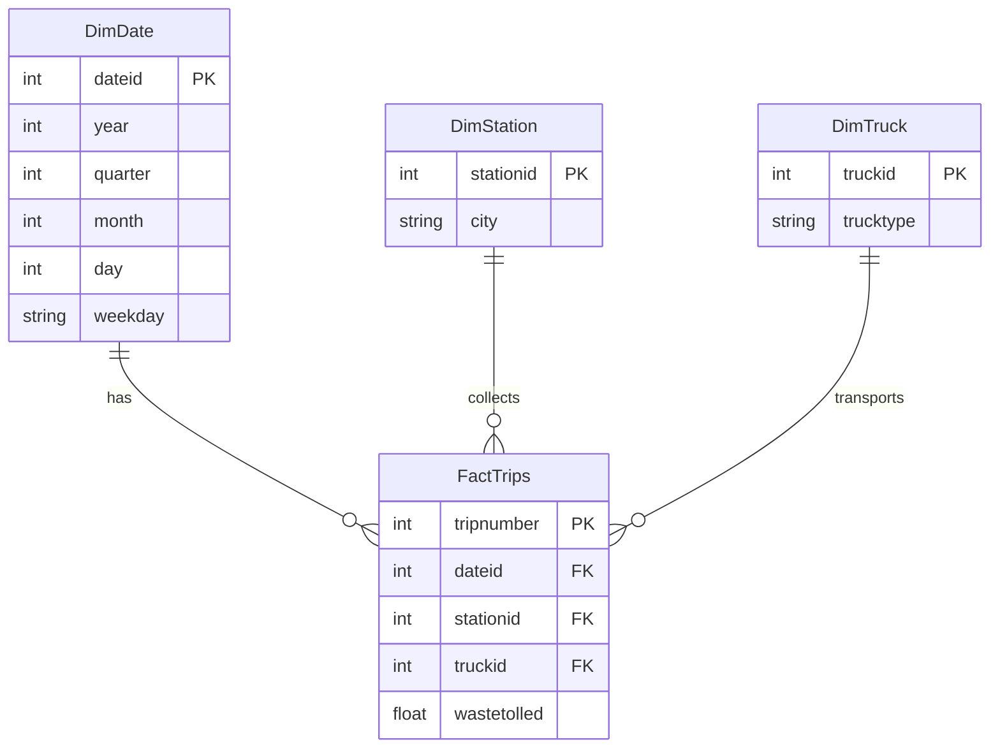

# Solid Waste Management Data Warehouse — Star Schema, CUBE, ROLLUP & Materialized Views

An enterprise data warehousing solution designed for a municipal solid waste management corporation implementing star schema modeling, multidimensional aggregations (`GROUPING SETS`, `ROLLUP`, `CUBE`), and materialized view optimization in **PostgreSQL**.

---

## 📌 Executive Summary

Municipal sanitation and waste logistics management requires tracking millions of waste collection trips across vehicles, waste categories, collection zones, and time dimensions. This project implements a production-grade data warehouse:
1. **Star Schema Architecture**: Creates dimension tables (`DimDate`, `DimTruck`, `DimStation`, `DimWaste`, `DimZone`) and a central fact table (`FactTrips`) recording waste tonnage.
2. **Bulk Ingestion & Schema Integrity**: Loads over 2.4 million rows of operational trip logs (`FactTrips.csv`) and dimensional lookup datasets.
3. **Advanced Multidimensional Aggregations**:
   - `GROUPING SETS`: Computes targeted multi-level subtotals across stations and trucks.
   - `ROLLUP`: Calculates hierarchical summaries across Year -> Quarter -> Month -> Day hierarchies.
   - `CUBE`: Generates all possible combinations of dimensional aggregates for cross-tabular OLAP exploration.
4. **Performance Tuning via Materialized Views**: Constructs pre-computed materialized views (`16-mv.png`) to cache heavy aggregate calculations and enable sub-second executive reporting.

---

## 🏗️ Dimensional Schema Architecture



---

## 📁 Project Structure

```text
c9_data_warehouse_fundamentals_final_project/
├── README.md                            # Comprehensive project documentation
├── c9_m3_final_project_assignment.md    # Full project assignment specification
├── DimDate.csv                          # Date dimension data
├── DimTruck.csv                         # Truck dimension data
├── DimStation.csv                       # Station dimension data
├── FactTrips.csv                        # Central fact table dataset (~2.4M records)
└── 1-MyDimDate.png ... 16-mv.png        # 16 graded submission screenshots
```

---

## 🛠️ Technology Stack

- **Data Warehouse Engine**: PostgreSQL
- **Modeling Paradigm**: Kimball Dimensional Modeling (Star Schema)
- **Analytical SQL**: `GROUPING SETS`, `ROLLUP`, `CUBE`, `MATERIALIZED VIEW`
