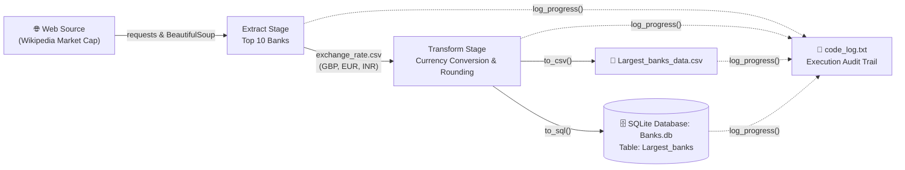

# Global Banking Market Cap ETL Pipeline — Python Project for Data Engineering

An automated end-to-end Python ETL data pipeline extracting global banking financial metrics via web scraping, transforming currency valuations across foreign exchange rates, and loading into tabular CSV and **SQLite** database stores with granular execution logging.

---

## 📌 Executive Summary

Financial analysts track the world's top banking institutions by market capitalization to assess global liquidity and systemic importance. This project implements an automated, production-ready ETL pipeline:
1. **Extraction (Web Scraping)**: Uses `BeautifulSoup` and `requests` to scrape HTML tables listing the top 10 largest banks by market capitalization from Wikipedia.
2. **Transformation (Multi-Currency Valuation)**: Reads foreign exchange conversion rates (`exchange_rate.csv`) and calculates market capitalization figures across four global currencies: USD, GBP, EUR, and INR, rounded to two decimal places.
3. **Loading (Dual Persistence)**: Saves the enriched DataFrame to disk as `Largest_banks_data.csv` and loads it into a local relational **SQLite** database (`Banks.db`) table `Largest_banks`.
4. **Execution Audit & Querying**: Automatically records millisecond-precision timestamps for every ETL phase into `code_log.txt` and executes SQL verification queries (average market cap, bank ranking).

---

## 🏗️ Pipeline Flow



---

## 📁 Project Contents

```text
course3-banks-project/
├── README.md                  # Comprehensive project documentation
├── banks_project.py           # Core ETL pipeline script
├── Banks.db                   # SQLite database containing Largest_banks table
├── Largest_banks_data.csv     # Extracted and transformed tabular dataset
└── code_log.txt               # Execution timestamp log
```

---

## 🛠️ Technology Stack

- **Python 3.10+**
- **BeautifulSoup 4** (HTML parsing and DOM traversal)
- **pandas & NumPy** (Vectorized math and DataFrame manipulation)
- **SQLite3** (Relational embedded database storage)
- **Requests** (HTTP client)
