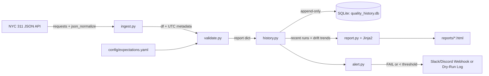

# Data Quality Checker with Automated Reports

A production-style data quality observability pipeline that ingests real-world **NYC 311 Service Requests** JSON data, validates expectations via **Great Expectations** driven by external YAML configuration, tracks historical drift in **SQLite**, renders self-contained **Jinja2 HTML reports**, and dispatches threshold-based **webhook alerts**.

---

## Architecture



---

## Tech Stack & Design Decisions

- **Ingestion (`ingest.py`):** Uses `requests.get(timeout=15)` + `pd.json_normalize()` instead of `pd.read_json()` to enforce socket timeouts, handle HTTP/empty-payload errors loudly, flatten nested geospatial `location` objects, and separate run-level UTC metadata from row data.
- **Validation (`validate.py` + `config/expectations.yaml`):** Decouples thresholds from Python code using YAML + an ephemeral **Great Expectations** context (`mode="ephemeral"`), evaluating all checks in one pass (collect-all) after coercing string-encoded JSON numbers/timestamps.
- **Historical Drift Tracking (`history.py`):** Uses a normalized 1-to-many **SQLite** schema (`validation_runs` -> `check_results`) with atomic transactions, `PRAGMA foreign_keys = ON`, and `WHERE run_id != ?` baseline queries to detect pass-rate deltas, volume drops, and check-level degradation.
- **Reporting & Alerting (`report.py`, `templates/report.html`, `alert.py`):** Renders offline-ready HTML5 reports with Jinja2 autoescaping (`select_autoescape(["html"])`), and dispatches non-blocking webhook alerts via `WEBHOOK_URL` (with a safe dry-run log fallback when unset).

---

## Project Structure

```text
data_quality_checker/
├── config/
│   └── expectations.yaml    # Declarative dataset & column expectations
├── templates/
│   └── report.html          # Self-contained Jinja2 HTML report template
├── tests/
│   ├── test_validate.py     # Unit tests for Great Expectations rules
│   ├── test_history.py      # Unit tests for SQLite persistence & drift
│   ├── test_alert_report.py # Unit tests for HTML escaping & webhook safety
│   └── test_pipeline.py     # Offline end-to-end integration test
├── ingest.py                # Defensive JSON API ingestion + logging
├── validate.py              # Config-driven Great Expectations runner
├── history.py               # SQLite history store & drift analyzer
├── report.py                # Jinja2 HTML report generator
├── alert.py                 # Threshold-based webhook alerter
├── main.py                  # CLI orchestrator (exit 1 on FAIL)
└── requirements.txt
```

---

## Quickstart

### 1. Setup Environment
```powershell
python -m venv .venv
.\.venv\Scripts\Activate.ps1
pip install -r requirements.txt
```

### 2. Run the Pipeline
```powershell
# Optional: set a Slack/Discord incoming webhook URL
$env:WEBHOOK_URL = "https://hooks.slack.com/services/..."

python main.py --limit 1000
```
- Generates a timestamped report in `reports/quality_report_<YYYYMMDD_HHMMSS>.html`.
- Exits with code `0` on `PASS` or `1` on `FAIL` (suitable for CI/CD or Airflow gates).

### 3. Run Automated Tests (Offline)
```powershell
pytest -v
```
